# Qampaign — QuantumSentinel campaign decision pipeline

A three-stage quantum-classical workflow for a bank deposit campaign. Built for the **Atomiq / Qiskit Fall Fest 2026** hackathon (QuantumSentinel track, IEM Kolkata + IBM Quantum).

📽️ **Presentation:** [View the slides on Canva](https://canva.link/bffmfq6pr4ocub8)


1. **Stage 1 — predict:** which of 100 unlabeled customers will respond? (classical logistic regression vs a ZZ quantum-kernel SVC, nested repeated CV)
2. **Stage 2 — select:** pick exactly 6 of the top 10 under a contact-cost budget and a capacity limit (exact search is the submitted answer; Dicke/XY QAOA is a comparison)
3. **Stage 3 — simulate:** a 6-qubit circuit estimates the probability that at least 3 of the 6 selected customers respond

> **Honest summary:** the classical logistic model wins Stage 1. QAOA reproduces the exact optimum on a 210-subset problem, which is trivial to brute-force. **No quantum advantage is claimed.** Everything quantum runs on simulators; no IBM hardware was used.

---

## Table of contents

1. [Headline results](#1-headline-results)
2. [Quickstart](#2-quickstart)
3. [Repository map — what each file does](#3-repository-map--what-each-file-does)
4. [Backend architecture](#4-backend-architecture)
5. [Data and provenance](#5-data-and-provenance)
6. [Stage 1 — formulas and approach](#6-stage-1--formulas-and-approach)
7. [Stage 1 — results](#7-stage-1--results)
8. [Stage 2 — formulation, QAOA, results](#8-stage-2--formulation-qaoa-results)
9. [Stage 3 — simulation and results](#9-stage-3--simulation-and-results)
10. [Noise, transpilation and uncertainty](#10-noise-transpilation-and-uncertainty)
11. [Quantum specs table](#11-quantum-specs-table)
12. [Notebook figures](#12-notebook-figures)
13. [Limitations](#13-limitations)
14. [Business impact and recommendation](#14-business-impact-and-recommendation)
15. [Reproducibility and testing](#15-reproducibility-and-testing)


---

## 1. Headline results

| Item | Value |
|---|---|
| Training data | 300 labeled customers, 35 positives (11.67% base rate) |
| Test data | 100 unlabeled customers (predicted once, never used for tuning) |
| Chosen Stage 1 model | Regularized logistic regression + Platt calibration (lowest nested-CV log loss) |
| Logistic ROC-AUC / PR-AUC | 0.619 / 0.226 |
| ZZ quantum-kernel SVC ROC-AUC / PR-AUC | 0.608 / 0.149 |
| Selected 6 customers | **C0081, C0031, C0079, C0222, C0087, C0256** |
| Stage 2 objective (workbook units) | **16.122** |
| Contact cost / capacity used | 13 of 25 / 11 of 22 |
| QAOA best-of-80 optimum mass | 37.9% (random chance 0.48%, median run 0.68%) |
| P(at least 3 of 6 respond), exact | **0.181754** |
| Same, 20,000-shot ideal Aer | 0.1810 (95% Wilson 0.1757 to 0.1864) |
| Same, 1M-trial Monte Carlo | 0.181689 |
| Same, synthetic noise | 0.20195 raw, 0.19038 readout-mitigated |

---

## 2. Quickstart

Tested with **Python 3.13** (3.13.5). Run from the repository root:

```bash
python -m pip install -r requirements.txt
python -m unittest discover -s tests
python main.py
```

- `main.py` runs all three stages and rewrites the result files. No cloud account is needed; MLflow logs locally to `results/mlflow.db` (created at runtime, git-ignored).
- The notebook `notebooks/customer_selection_workbook.ipynb` runs the same pipeline (or reuses saved outputs) and shows the plots and circuit drawings inline.
- Settings live in `settings.yaml`. All versions are pinned in `requirements.txt`.

---

## 3. Repository map — what each file does

### Root

| File | What it does |
|---|---|
| `main.py` | Entry point. Calls `run_pipeline()`. |
| `settings.yaml` | Every knob: seed 42, CV folds/repeats, hyperparameter grids, feature sets, QAOA depth/restarts/shots, QUBO penalty, Stage 3 shots, diagnostics sizes. |
| `requirements.txt` | Pinned dependencies (Qiskit 2.6.2, Aer 0.18.2, scikit-learn 1.9.1, MLflow 3.18.0, …). |
| `LICENSE` | MIT. |
| `stage1_predictions.csv` |  All 100 test customers: `customer_id, predicted_probability, rank, is_top_10`. |
| `stage2_selection.csv` | The 10 ranked candidates with economics, net value and a `selected` flag (6 are true). |
| `stage2_selection.json` | Selected IDs, budget/capacity used and limits, objective, measured QAOA bitstrings and counts, brute-force optimum, optimality gaps, transpilation stats. |
| `stage3_simulation.csv` | Per-qubit customer, probability, circuit estimate, exact value, Monte Carlo value. |
| `stage3_simulation.json` | Circuit angles, counts, estimates, errors, Monte Carlo, transpilation, noise comparison, uncertainty propagation. |

### `src/customer_pipeline/` — the backend

| File | What it does |
|---|---|
| `pipeline.py` | Orchestrator. Seeds everything, loads the workbook, starts an MLflow run, runs Stage 1 → 2 → 3, logs metrics, exports judge-facing artifacts, writes `results/run_summary.json`. |
| `workbook.py` | Reads the organizer Excel file. Validates sheets, row counts (300/100/400), unique IDs, yes/no labels, no `duration` column, no test labels, constraints N=10, K=6, and resolves test IDs (workbook IDs, mapping file, or a PROVISIONAL fallback). |
| `stage1.py` | Feature engineering, logistic pipeline, quantum-kernel SVC, 40-setting tuning per family, nested repeated CV, Platt calibration, bootstrap and t-intervals, calibration table, kernel-target alignment, all Stage 1 plots and CSVs. |
| `stage2.py` | Expected net value, exact search over all 210 subsets, slack QUBO builder and its brute-force check, Dicke/XY QAOA (COBYLA and SPSA sweeps, Aer sampling), rank-10/11 robustness swap, convergence plot. |
| `stage3.py` | Builds the 6-qubit RY circuit, samples it on Aer, computes the exact Poisson-binomial probability, Wilson interval, sensitivity table. |
| `submission_artifacts.py` | Post-processing: writes the root CSV/JSON files, transpiles the best QAOA and Stage 3 circuits on a linear coupling map, runs the Monte Carlo benchmark, the synthetic-noise run with readout mitigation, and the uncertainty stress test. |

### `src/eval_extras/`

| File | What it does |
|---|---|
| `metrics.py` | Small tested metric helpers: `pr_auc` (trapezoidal), `multiclass_brier`, `precision_recall_at_k`. Stage 1 uses `pr_auc`. |

### `tests/`

| File | What it checks |
|---|---|
| `test_customer_stage1.py` | Tie-breaking by customer ID, feature engineering and angle range, equal 40-setting budgets for both model families, rejection of test labels and `duration`, model choice using only train CV log loss. |
| `test_eval_extras_metrics.py` | PR-AUC, Brier and precision/recall@k formulas and input validation. |
| `test_workbook_pipeline.py` | Workbook IDs, labels and constraints; provisional and explicit ID mapping; six-unique-customer rule; Dicke/XY QAOA stays in the weight-six sector and the vectorized objective matches the circuit; QUBO minimum equals brute force; little-endian decoding; exact probability; root artifact schemas match package results. |

### `notebooks/`, `data/`, `docs/`, `results/`

| Path | What it is |
|---|---|
| `notebooks/customer_selection_workbook.ipynb` | Walkthrough: preprocessing checks, classical vs quantum baselines, QUBO/Dicke formulation, QAOA circuit and convergence, Stage 3 circuit and counts. Figures are embedded. |
| `data/bank_campaign_participant_release.xlsx` | Organizer workbook (sheets: README, Stage1_Train, Stage1_Test, Stage2_Data, Stage2_Constraints). |
| `data/WORKBOOK_SHA256.txt` | Hash of the workbook for provenance. |
| `docs/EXECUTIVE_REPORT.md` | One-page results and limits summary. |
| `docs/images/notebook_*.png` | Six figures exported from the notebook outputs (bar comparison, calibration, QAOA p=1 circuit, QAOA convergence, Stage 3 circuit, Stage 3 counts vs exact). Shown in README section 12. |
| `results/RUN_INFO.md` | Seeds, versions, backends, shots, qubit counts. |
| `results/run_summary.json` | Machine-readable run summary. |
| `results/stage1_cv_metrics.csv/.json` | Every nested-CV metric with both interval types. |
| `results/stage1_calibration_curve.csv` | Out-of-fold calibration bins including the top decile. |
| `results/stage1_quantum_kernel_matrix.csv`, `stage1_quantum_qubit_feature_order.csv` | The train-only ZZ kernel and which source features feed each qubit. |
| `results/stage1_predictions.csv`, `stage2_selection.csv/.json`, `stage3_simulation.csv/.json` | Package-local copies of the stage outputs. |
| `results/stage2_qaoa_sweep.csv` | All 80 QAOA runs (p, optimizer, restart, seed, objective, optimum mass). |
| `results/stage3_sensitivity.csv` | P(at least 3 of 6) under fixed per-customer rates. |
| `results/*.png` | The four figures shown below. |

---

## 4. Backend architecture

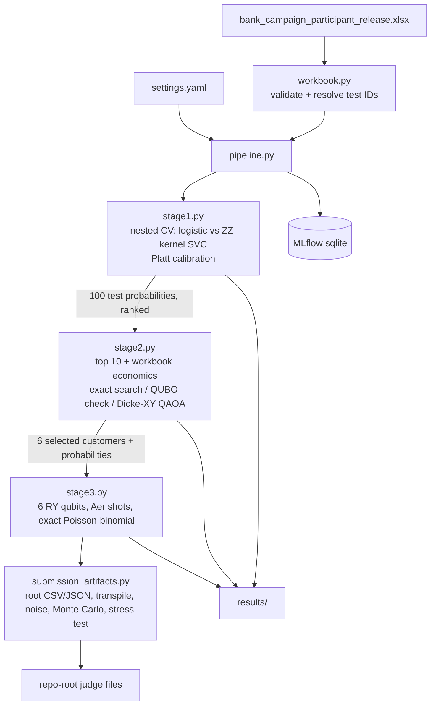

Key design rules enforced in code:

- The **same Stage 1 probabilities** flow into Stages 2 and 3.
- All scalers, encoders, SVD, feature/model selection, calibration and tuning are fitted **inside training folds only**.
- The workbook loader refuses test labels and any `duration` column.
- Selection never uses the QAOA result; exact enumeration is the submitted answer.

---

## 5. Data and provenance

- **Stage1_Train:** 300 rows with `y` (yes/no). **Stage1_Test:** 100 rows, no labels. **Stage2_Data:** 400 rows with `contact_cost`, `expected_deposit_value`, `capacity_units`, `customer_segment`. **Stage2_Constraints:** N=10 candidates, K=6 selected, C=25 budget, H=22 capacity.
- `duration` is excluded because it is only known after a call.
- **ID caveat:** the organizer's description says Stage1_Test has no `customer_id`, but the packaged workbook contains 100 explicit IDs, which the loader validates (unique, disjoint from train, present in Stage2_Data) and uses directly. For an ID-less copy, set `customer_project.id_mapping` to a CSV/XLSX with 1-based `test_row` and `customer_id`. Without IDs or a mapping, test row order is paired with the sorted missing IDs and every output is marked `PROVISIONAL_ROW_ORDER`.
- Workbook SHA256: `D2F8E63705AF2883C7618C463A6AC2F351119D59A8869D2677F8825148E9A709`

---

## 6. Stage 1 — formulas and approach

### Feature engineering (deterministic, nothing learned from held-out rows)

`balance_log_signed = sign(b) · ln(1 + |b|)`  and  `campaign_log = ln(1 + max(c, 0))`

Plus flags: `previously_contacted = [pdays ≥ 0]`, `previous_positive = [previous > 0]`, `poutcome_success = [poutcome = success]`. Numeric columns are standardized and categoricals one-hot encoded.

### Classical model

$$P(y=1\mid x)=\sigma(w^\top x+b),\qquad \min_{w,b}\ \tfrac12\|w\|^2+C\sum_i \ell_i$$

Tuning budget **40 settings**: 2 feature sets (all / compact) × C ∈ {0.03, 0.1, 0.3, 1.0} × 5 class weights (none, balanced, 1:2, 1:4, 1:6). Inner 3-fold CV, scored by negative log loss.

### Quantum-kernel model

Pipeline: compact features → `TruncatedSVD` to q ∈ {4, 6} components → `MinMaxScaler` to [0, π] → scale s ∈ {0.5, 1.0} with clipping → `ZZFeatureMap` (linear entanglement, reps ∈ {1, 2}).

$$K(x,x')=\big|\langle\phi(x)\mid\phi(x')\rangle\big|^2$$

computed by exact statevector (0 shots), fed to `SVC(kernel="precomputed", class_weight="balanced")`, C ∈ {0.01, 0.1, 1, 10, 100}. Also **40 settings** (2 × 2 × 2 × 5), scored by inner ROC-AUC. Ranking uses `decision_function`, never SVC's built-in probability.

### Calibration

Platt (sigmoid) calibration via `CalibratedClassifierCV` with 3 folds, fitted inside each outer training fold. No isotonic.

### Validation and model choice

Nested repeated stratified CV: **outer 5 repeats × 5 folds**, inner 3-fold tuning, identical folds for both families. The family with the lower mean outer **log loss** wins. The final model is refit on all 300 training rows and predicts the test set once.

### Metrics

$$\text{Brier}=\tfrac1n\sum_i(p_i-y_i)^2,\qquad \text{LogLoss}=-\tfrac1n\sum_i\big[y_i\ln p_i+(1-y_i)\ln(1-p_i)\big]$$

$$\text{Precision@}k=\frac{\text{positives in top }k}{k},\qquad \text{Recall@}k=\frac{\text{positives in top }k}{35}$$

### Intervals

- **Repeated-CV:** $\bar m \pm t_{0.975,4}\,s/\sqrt5$ over the five outer-repeat metrics.
- **OOF bootstrap:** 1,000 stratified resamples of pooled out-of-fold (label, probability) pairs, 2.5th to 97.5th percentile.
- Repeated-CV intervals understate uncertainty because folds overlap. The bootstrap intervals are the more honest ones.

### Kernel-target alignment

With centered $K_c$ and $T_c$ from $T=yy^\top$, $y\in\{-1,+1\}$:

$$A=\frac{\langle K_c,T_c\rangle_F}{\|K_c\|_F\,\|T_c\|_F}$$

---

## 7. Stage 1 — results

### Classical logistic (selected)

| Metric | Mean | Repeated-CV 95% | OOF bootstrap 95% |
|---|---|---|---|
| ROC-AUC | 0.619 | 0.577 to 0.661 | 0.515 to 0.717 |
| PR-AUC | 0.226 | 0.193 to 0.259 | 0.137 to 0.365 |
| Precision@10 | 0.600 | no spread | 0.200 to 0.800 |
| Precision@20 | 0.310 | 0.282 to 0.338 | 0.100 to 0.550 |
| Precision@30 | 0.213 | 0.191 to 0.236 | 0.100 to 0.400 |
| Recall@10 | 0.171 | no spread | 0.057 to 0.229 |
| Recall@20 | 0.177 | 0.161 to 0.193 | 0.057 to 0.314 |
| Recall@30 | 0.183 | 0.163 to 0.202 | 0.086 to 0.343 |
| Brier | 0.097 | 0.096 to 0.099 | 0.089 to 0.104 |
| Log loss | 0.342 | 0.336 to 0.348 | 0.317 to 0.363 |

### ZZ quantum-kernel SVC

| Metric | Mean | Repeated-CV 95% | OOF bootstrap 95% |
|---|---|---|---|
| ROC-AUC | 0.608 | 0.582 to 0.633 | 0.535 to 0.704 |
| PR-AUC | 0.149 | 0.131 to 0.167 | 0.117 to 0.188 |
| Brier | 0.102 | 0.101 to 0.103 | 0.100 to 0.103 |
| Log loss | 0.354 | 0.349 to 0.359 | 0.343 to 0.361 |

Quantum fold-level ROC-AUC is 0.614 (0.576 to 0.653) on the raw decision score and 0.607 (0.572 to 0.642) after Platt probabilities. Kernel-target alignment is only **0.034**.

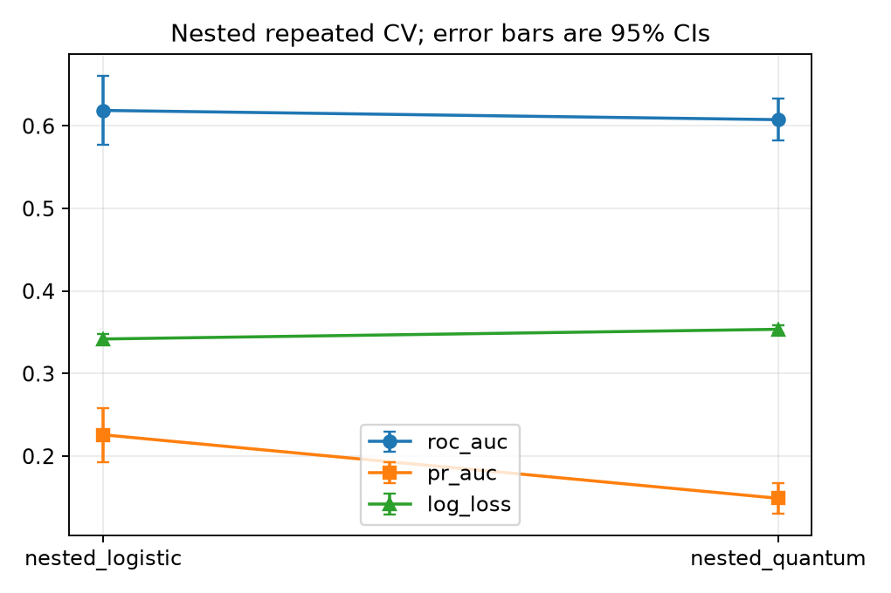

**Figure 1 — `results/stage1_cv_comparison.png`.** Mean ROC-AUC, PR-AUC and log loss for the classical (`nested_logistic`) and quantum (`nested_quantum`) models under identical nested repeated CV, with 95% error bars. ROC-AUC overlaps, but the classical model is clearly ahead on PR-AUC and slightly better (lower) on log loss.

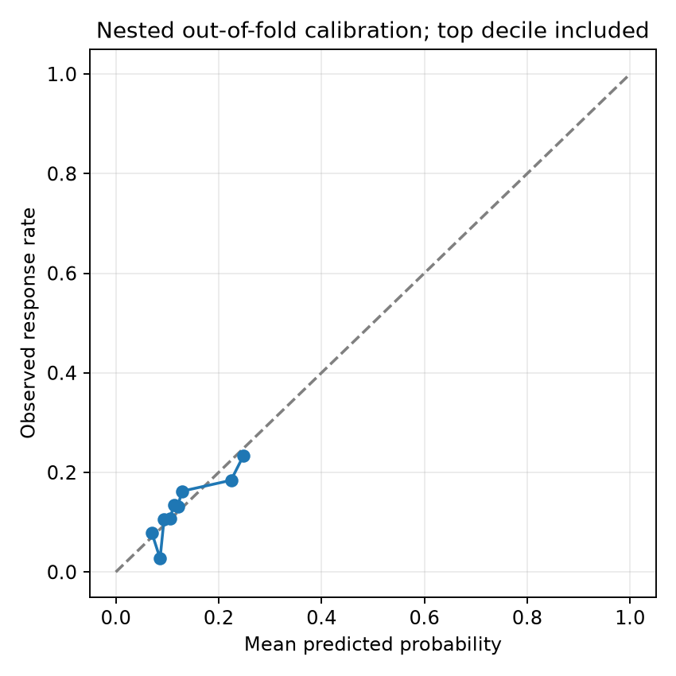

**Figure 2 — `results/stage1_calibration.png`.** Mean predicted probability (x) against observed response rate (y) for the winning model, using pooled out-of-fold predictions in quantile bins plus an explicit top-decile bin. Points near the dashed diagonal mean well-calibrated probabilities. They track it reasonably but are noisy because each bin holds only about 37 customers. Out-of-fold predictions never exceed about 0.54.

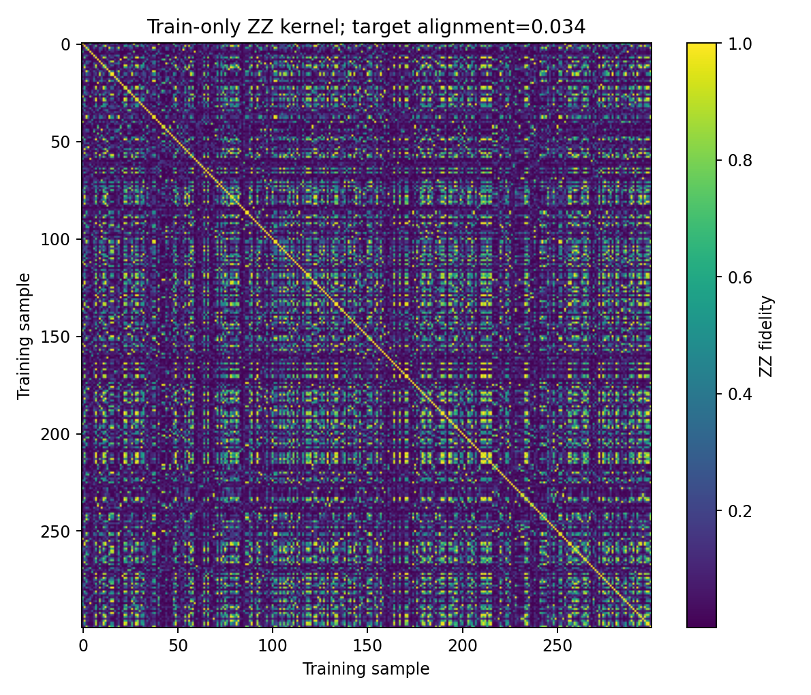

**Figure 3 — `results/stage1_quantum_kernel_matrix.png`.** The 300 × 300 ZZ fidelity kernel on the training set (colour = state overlap). A useful kernel would show visible block structure separating responders from non-responders. This one is diffuse and noisy, matching its low target alignment (0.034), which is why the quantum model does not beat logistic regression.

### What drives Precision@10 = 0.600

The same ten customers rank first in every repeat. They are exactly the ten training customers with `poutcome = success`, and six of them subscribed. So Precision@10 is essentially **one feature**, not a rich model. This is why it has zero spread across repeats.

### Test predictions: only three clear leaders

| Rank | Customer | Probability |
|---|---|---|
| 1 | C0081 | 0.3983 |
| 2 | C0031 | 0.3719 |
| 3 | C0079 | 0.3323 |
| 4–10 | C0183, C0222, C0318, C0345, C0087, C0338, C0256 | 0.153 to 0.168 |
| 11 | C0397 | 0.1515 |

Rank 11 (C0397) sits only 0.0013 below rank 10 (C0256). Swapping them changes the exact selection to C0081, C0031, C0079, C0222, C0087, **C0397** (objective 16.122 → 17.306; five of six IDs overlap). This is a robustness note only and does not change the submission. The test top-ten range (0.153 to 0.398) lies inside the out-of-fold calibrated range (0.052 to 0.536).

---

## 8. Stage 2 — formulation, QAOA, results

### Problem

For the top-10 candidates, let $p_i$ be the Stage 1 probability, $D_i$ the expected deposit value, $c_i$ the contact cost, $h_i$ the capacity units. The expected net value is

$$v_i=p_i D_i-c_i$$

$$\max_{x\in\{0,1\}^{10}}\ \sum_i v_i x_i\quad\text{s.t.}\quad \sum_i x_i=6,\ \ \sum_i c_i x_i\le 25,\ \ \sum_i h_i x_i\le 22$$

### Exact search (the submitted answer)

All $\binom{10}{6}=210$ subsets are enumerated and checked. All 210 are feasible: the maximum six-customer cost is 18 and the maximum capacity is 17, so **both resource limits are inactive** for this pool. The best subset:

| Customer | p | Cost | Deposit value | Capacity | Segment | Net value $v_i$ |
|---|---|---|---|---|---|---|
| C0081 | 0.3983 | 4 | 17 | 1 | C | 2.771 |
| C0031 | 0.3719 | 2 | 13 | 1 | D | 2.834 |
| C0079 | 0.3323 | 3 | 24 | 3 | A | 4.976 |
| C0222 | 0.1605 | 2 | 21 | 1 | D | 1.370 |
| C0087 | 0.1561 | 1 | 18 | 1 | D | 1.810 |
| C0256 | 0.1528 | 1 | 22 | 4 | A | 2.361 |
| **Total** | | **13 / 25** | | **11 / 22** | | **16.122** |

Rank-4 C0183 and rank-9 C0338 are left out not because of constraints but because their net value is low (0.348 and 0.760): low deposit value relative to cost.

### Alternative QUBO encoding (20 qubits)

Slack bits turn the inequalities into equalities (5 budget slack bits, 5 capacity slack bits, plus 10 decision bits). With $x=(1-Z)/2$ for the Ising form and penalty $P=10{,}000$:

$$E(x,s,t)=-\sum_i v_i x_i+P\Big[\big(\textstyle\sum_i x_i-6\big)^2+\big(\textstyle\sum_i c_i x_i+\sum_j 2^j s_j-25\big)^2+\big(\textstyle\sum_i h_i x_i+\sum_j 2^j t_j-22\big)^2\Big]$$

The code verifies that the QUBO minimum equals the negative brute-force optimum, and raises an error otherwise. It is retained as a check, not used for the submission.

### Dicke/XY QAOA (10 qubits, no slack)

- **Initial state:** uniform Dicke state over all weight-6 bitstrings, $|D^{10}_6\rangle=\tfrac1{\sqrt{210}}\sum_{|x|=6}|x\rangle$.
- **Cost layer:** $R_Z$ rotations from normalized values $\tilde v_i=v_i/\max|v|$.
- **Mixer:** complete-graph XY mixer (`RXX(β)` then `RYY(β)` on every pair). It preserves Hamming weight, so cardinality is always exactly 6.
- **Constraints:** budget and capacity are checked after decoding the measured bitstring.

$$|\psi(\gamma,\beta)\rangle=\prod_{l=1}^{p}e^{-i\beta_l H_{XY}}e^{-i\gamma_l H_C}\,|D^{10}_6\rangle$$

- **Sweep:** p ∈ {1, 2, 3, 4} × {COBYLA, SPSA} × 10 restarts = **80 optimized settings**, 200 iterations each, 8,192 Aer shots per setting. During optimization a vectorized exact statevector evaluates the expectation.
- **Seeds:** `42 + p·10000 + (0 for COBYLA, 5000 for SPSA) + restart`.

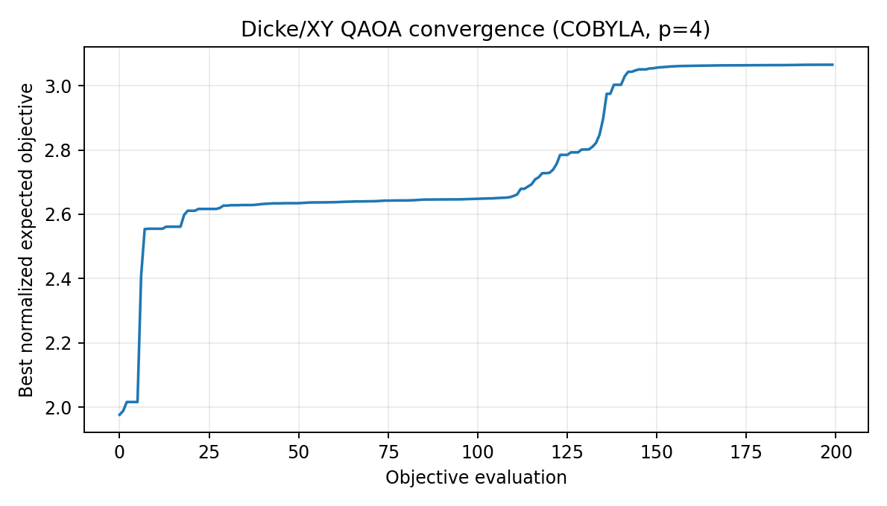

**Figure 4 — `results/stage2_qaoa_convergence.png`.** Best normalized expected objective (y) against objective evaluation (x) for the winning run (COBYLA, p=4). The curve jumps from about 2.0 to about 2.55 within the first ten evaluations, sits on a plateau near 2.6, then climbs again between roughly evaluations 110 and 145 and flattens at about 3.07. That second climb shows the optimizer escaping a local plateau, so more iterations or restarts matter for QAOA here.

### QAOA results

| Quantity | Value |
|---|---|
| Best-of-80 optimum probability mass | 3,105 / 8,192 = **37.9%** |
| Best settings | COBYLA, p=4, restart 4, optimizer seed 40046, simulator seed 42 |
| Random-subset chance | 1/210 = 0.48% |
| Median across the 80 runs | 0.68% |
| Runs reaching at least 10% mass | 3 of 80 |
| Feasibility of sampled bitstrings (best run) | 100% |
| Best sampled objective / optimality gap | 16.122 / 0 (absolute and relative) |

QAOA matches the exact optimum in this run. **The 37.9% figure is the best of 80 runs, chosen by looking at the known optimum, so it is not a typical-run guarantee** (the median is 0.68%).

### Robustness

A 10,000-draw stress test (see section 10) keeps the same six customers as the exact optimum in 100% of draws.

---

## 9. Stage 3 — simulation and results

Each of the 6 selected customers is one qubit prepared by

$$R_Y\!\big(2\arcsin\sqrt{p_i}\big)|0\rangle\ \Rightarrow\ P(\text{measure }1)=p_i$$

Success means **at least 3 of 6 qubits read 1**. Qubit order is C0081, C0031, C0079, C0222, C0087, C0256 (qubits 0–5). Qiskit count strings are little-endian: qubit 0 is the rightmost character.

Because the qubits are independent, the exact answer is a Poisson-binomial tail, computed by dynamic programming:

$$P(S\ge3)=\sum_{k=3}^{6}P(S=k),\qquad P_{n}(k)=P_{n-1}(k)(1-p_n)+P_{n-1}(k-1)\,p_n$$

| Estimator | P(at least 3 of 6) | Notes |
|---|---|---|
| **Exact** | **0.181754** | Poisson-binomial |
| Ideal Aer, 20,000 shots, seed 42 | 0.1810 | 95% Wilson 0.1757 to 0.1864 |
| Independent Bernoulli Monte Carlo, 1,000,000 draws, seed 42 | 0.181689 | Wilson 0.180934 to 0.182446; abs. error 0.000065 |

Sensitivity (`results/stage3_sensitivity.csv`), if every customer had the same rate:

| Per-customer probability | P(at least 3 of 6) |
|---|---|
| 0.10 | 0.0159 |
| 0.15 | 0.0473 |
| 0.20 | 0.0989 |
| 0.25 | 0.1694 |
| submitted six probabilities | 0.1818 |

The Stage 3 circuit is just six single-qubit rotations and six measurements: depth 5, no two-qubit gates. It is a faithful but very simple circuit, since independent Bernoulli sampling needs no entanglement.

The Stage 3 circuit drawing and the Stage 2 QAOA schematic are in [section 12](#12-notebook-figures).

---

## 10. Noise, transpilation and uncertainty

### Transpilation (simulated linear topology, not an IBM device)

Qiskit `AerSimulator` with a linear coupling map, basis gates {rz, sx, x, cx}, optimization level 1, `seed_transpiler=42`, identity layout.

| Circuit | Qubits (logical/mapped) | Depth | Gates |
|---|---|---|---|
| Stage 2 best QAOA (p=4) | 10 / 10 | **5,376** | 1,733 CX, 3,753 RZ, 2,168 SX, 147 X (+10 measure) |
| Stage 3 | 6 / 6 | 5 | 12 RZ, 12 SX, no two-qubit gates (+6 measure) |

> The reported Stage 2 transpiled depth (5,376; 1,733 CX) includes generic state preparation of the weight-six Dicke state and routing of the all-to-all XY mixer on a linear topology, so a dedicated Dicke circuit would be shallower.

### Synthetic noise on Stage 3

Depolarizing error 0.005 on 1-qubit X/SX, 0.02 on CX, readout assignment errors 0.02 / 0.03, 20,000 shots.

| | Estimate | Absolute error vs exact |
|---|---|---|
| Unmitigated | 0.20195 | 0.02020 |
| Tensor-product readout inversion, $p_{\text{corr}}=A^{-1}p_{\text{obs}}$ | 0.19038 | 0.00863 |

The mitigated interval covers shot sampling only, not readout-calibration uncertainty. No IBM backend or hardware was used.

### Stage 1 uncertainty stress test

10,000 draws apply one shared additive offset to all ten candidate probabilities. The offset is sampled uniformly from the top-decile out-of-fold calibration interval (observed-rate CI 0.118 to 0.409 around a mean prediction of 0.248, i.e. offsets from −0.130 to +0.161).

- The submitted six remain the exact Stage 2 optimum in **100%** of draws.
- Stage 3 exact-probability 2.5th / 50th / 97.5th percentiles: **0.0291 / 0.2079 / 0.4899**.
- This is a group-level proxy, not customer-specific test confidence intervals (test labels do not exist).

---

## 11. Quantum specs table

| Stage | SDK / backend | Logical / mapped qubits | Transpiled depth / gates | Shots | Seeds |
|---|---|---|---|---|---|
| Stage 1 ZZ kernel | Qiskit 2.6.2 exact statevector | 4 (or 6) / N/A | Exact kernel, no gate transpilation | 0 | 42 |
| Stage 2 QAOA | Qiskit AerSimulator, linear simulated topology | 10 / 10 | Depth 5,376; CX 1,733; RZ 3,753; SX 2,168; X 147 | 8,192 × 80 | derived optimizer seeds; simulator 42; transpiler 42 |
| Stage 3 ideal | Qiskit AerSimulator | 6 / 6 | Depth 5; RZ 12; SX 12; 2-qubit 0 | 20,000 | simulator 42; transpiler 42 |
| Stage 3 noisy | Qiskit AerSimulator, synthetic noise | 6 / 6 | Same circuit | 20,000 | simulator 42; transpiler 42 |
| Stage 3 Monte Carlo | NumPy | N/A | N/A | 1,000,000 trials | 42 |

Libraries: Qiskit 2.6.2, qiskit-machine-learning 0.9.1, qiskit-algorithms 0.4.0, qiskit-aer 0.18.2, qiskit-optimization 0.7.0.

---

## 12. Notebook figures

These six figures are the outputs embedded in `notebooks/customer_selection_workbook.ipynb`, saved here in `docs/images/` so they show in the README. Figures 1 to 4 above come from the pipeline's own `results/*.png` files; these come from the notebook cells and cover the circuits too.

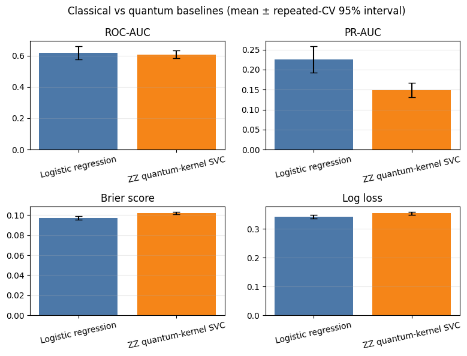

**Figure 5 — Classical vs quantum baselines (notebook section 2).** Four bar panels (ROC-AUC, PR-AUC, Brier score, log loss) comparing logistic regression (blue) with the ZZ quantum-kernel SVC (orange). Bars are means; black whiskers are repeated-CV 95% intervals. ROC-AUC is nearly equal (0.619 vs 0.608). Logistic is clearly higher on PR-AUC (0.226 vs 0.149) and lower on Brier (0.097 vs 0.102) and log loss (0.342 vs 0.354). For Brier and log loss, lower is better. This is the reason the classical model is selected.

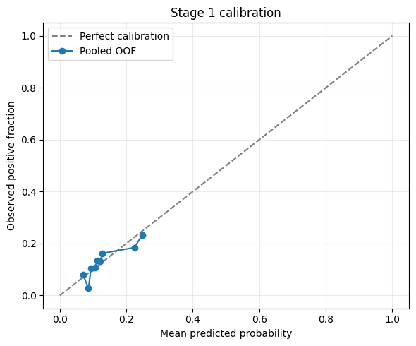

**Figure 6 — Stage 1 calibration (notebook section 2).** Pooled out-of-fold predicted probability (x) vs observed positive fraction (y) for the selected model, against the dashed perfect-calibration diagonal. Points stay close to the diagonal across the 0.07 to 0.25 range, with some noise because each bin holds only about 37 customers. There is no data above about 0.25 mean prediction, so high-probability calibration is untested. This is the same curve as Figure 2, drawn with a legend.

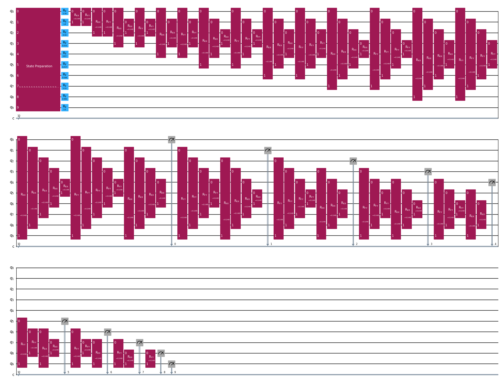

**Figure 7 — Stage 2 QAOA circuit, compact p=1 schematic (notebook section 4).** Ten qubits (q0 to q9), folded across three rows. From left to right: (1) a single **State Preparation** block that loads the uniform weight-six Dicke state; (2) one **RZ** per qubit (blue), the cost-layer rotations carrying the normalized net values; (3) the **XY mixer**, an `RXX` then `RYY` gate (both with angle β = −0.148) on every one of the 45 qubit pairs; (4) ten measurements into the classical register `c`. It is deliberately a p=1 drawing for legibility. The real best run is p=4 and transpiles to depth 5,376 with 1,733 CX on a linear topology; this drawing has logical depth 37.

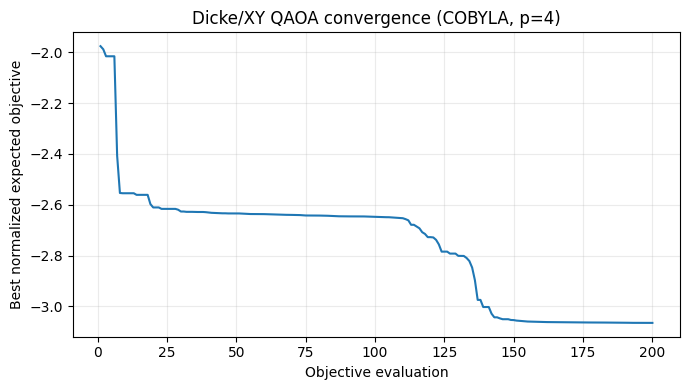

**Figure 8 — QAOA convergence, notebook version (notebook section 4).** Best normalized expected objective (y) against objective evaluation (x) for the winning run (COBYLA, p=4). Here the optimizer **minimizes the negative** of the objective, so the curve falls from about −2.0 to about −3.07. It is the mirror image of Figure 4, which plots the same run as a positive, rising curve. Two sharp drops (within the first ten evaluations, and again around evaluations 110 to 145) separated by a plateau near −2.6 show the optimizer escaping a local plateau.

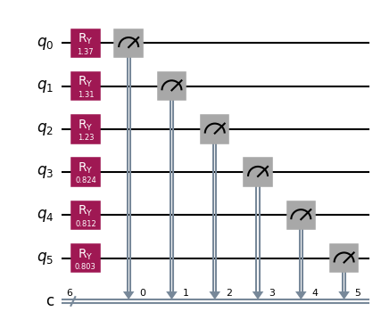

**Figure 9 — Stage 3 circuit (notebook section 5).** Six qubits, one per selected customer in order C0081, C0031, C0079, C0222, C0087, C0256. Each gets one `RY` gate with angle 2·arcsin(√p): 1.37, 1.31, 1.23, 0.824, 0.812, 0.803 radians. That makes each qubit read 1 with probability equal to the customer's predicted response probability. Each qubit is then measured into its own classical bit. There are no two-qubit gates, so the qubits are independent.

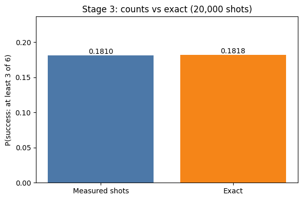

**Figure 10 — Stage 3 result (notebook section 5).** The fraction of 20,000 shots with at least 3 of 6 qubits equal to 1 (blue, 0.1810; 3,620 successful shots) next to the exact Poisson-binomial probability (orange, 0.1818, i.e. 0.181754). The 0.0008 gap is ordinary shot noise and sits well inside the 95% Wilson interval (0.1757 to 0.1864), so the circuit simulation agrees with the exact calculation.

---

## 13. Limitations

1. **Tiny signal.** Only 35 positive labels. Logistic ROC-AUC is 0.619 with an OOF bootstrap interval of 0.515 to 0.717, so the lower end is barely better than chance.
2. **Precision@10 is one feature.** The top-ten training ranking is just `poutcome = success`.
3. **Fragile top ten.** Only three test customers stand out; ranks 4 to 11 differ by tiny margins, and swapping rank 10 and 11 changes the selection.
4. **Costs and capacity are scenario inputs,** not measured business constraints. In this pool the budget and capacity limits never bind, so the optimization reduces to ranking by $v_i$ and picking the top six.
5. **The optimization is easy.** 210 subsets are trivial to enumerate. QAOA is a demonstration, and no quantum advantage exists here or is claimed.
6. **QAOA's 37.9% is best-of-80,** selected using knowledge of the optimum; the median run puts 0.68% of mass on it.
7. **Quantum kernel is weak** (alignment 0.034) and is evaluated only by exact simulation. The two model families also use different inner tuning criteria (log loss for logistic, ROC-AUC for the kernel); both are then compared by the same outer log loss.
8. **Everything is simulated.** Noise is a synthetic depolarizing/readout model, not a measured device. Readout mitigation intervals ignore calibration uncertainty.
9. **Stage 3 assumes independent responses** with calibrated probabilities. Any correlation between customers would change P(at least 3).
10. **The uncertainty stress test is a shared-offset proxy,** not per-customer intervals.
11. **Repeated-CV intervals are too narrow** because folds overlap; prefer the bootstrap intervals.
12. **Labels for the test set are unknown,** so none of the test-set outcomes are validated.

---

## 14. Business impact and recommendation

**What the numbers say (derived from the selected six):**

- Expected responders: sum of the six probabilities ≈ **1.57 of 6**.
- Chance at least one responds ≈ **85%**; chance at least three respond ≈ **18%**. Plan for "one or two responders", not "three or more".
- Expected deposit value ≈ 29.1 workbook units against a contact cost of 13, giving the 16.122 net objective. These are workbook scenario units, not guaranteed money.

**Recommendations:**

1. **Treat the six as a shortlist for a controlled pilot,** not a guaranteed win. Contact them, and measure actual response and deposit value.
2. **Prioritize the top three first** (C0081, C0031, C0079). They are the only customers the model separates clearly from the rest (0.33 to 0.40 versus about 0.15).
3. **Keep a reserve list.** Customers ranked 4 to 11 are nearly indistinguishable, so C0397 (rank 11) is a reasonable substitute for C0256 if the pilot has a reason to prefer it. It raises the objective to 17.306 but the difference is within noise.
4. **Run a holdout test** (contact vs not contact among similar customers) before scaling, so uplift can be measured instead of assumed.
5. **Collect more labels before investing in model complexity.** With 35 positives, better data will help more than a fancier model. Re-train and re-calibrate once the pilot adds outcomes.
6. **Replace the scenario costs and capacity** with real campaign numbers. If real limits bind, the exact search already handles them with no code change.
7. **Use the classical optimizer in production.** At this size exact search is instant and optimal. Revisit quantum optimization only for problems orders of magnitude larger, and only with a fair classical baseline.

Do not claim guaranteed campaign lift or quantum advantage.

---

## 15. Reproducibility and testing

- **Master seed 42.** CV split seed 42; inner CV seeds offset by split index; final full-train search offset 9000; calibration offsets 2000 / 4000 per outer split and 12000 for the final fit; bootstrap seed 42 (142 for the quantum metrics).
- **Model randomness:** logistic solver, SVD and stochastic steps use seed 42.
- **Transpiler:** optimization level 1, `seed_transpiler=42`.
- **Tests:** `python -m unittest discover -s tests` covers leakage guards, workbook validation, ID mapping, QAOA weight-six preservation, QUBO-vs-brute-force agreement, bit-order decoding, the exact probability, and the root artifact schemas.
- **Experiment tracking:** MLflow (local sqlite at `results/mlflow.db`, git-ignored).
- Full details: `results/RUN_INFO.md`.

Minor numeric differences across machines are possible in the QAOA optimum mass.

---


## License

MIT — see `LICENSE`.
